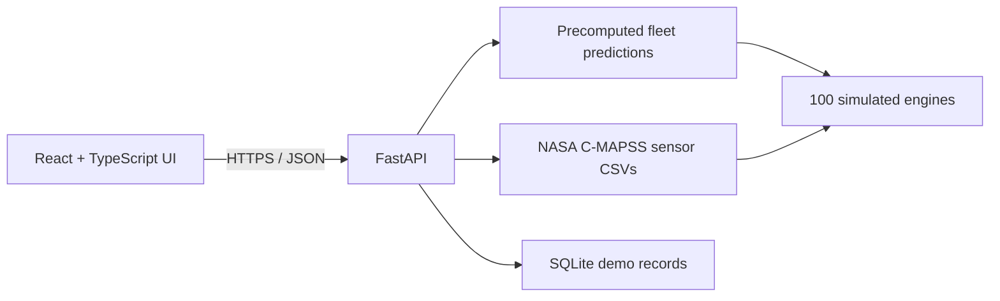

# AeroMind Maintenance Suite

**AeroMind** is a hackathon prototype that connects aircraft-engine health insights with a maintenance workflow. It combines a fleet dashboard, remaining useful life (RUL) estimates, anomaly indicators, interactive engine visualization, technician management, and work orders.

**Live demo:** [aeromind-maintenance-suite.onrender.com](https://aeromind-maintenance-suite.onrender.com/)  
**API docs:** [aeromind-koqx.onrender.com/docs](https://aeromind-koqx.onrender.com/docs)

> **Demo scope:** This public demo shows precomputed predictions based on simulated NASA C-MAPSS FD001 data. It does not ingest live aircraft telemetry or run new model inference for each request. It is an educational prototype, not a certified aviation maintenance or safety system. Demo records stored in SQLite on Render's free service are temporary and can be lost after a restart, sleep, or redeploy.

## What it demonstrates

- Fleet view for 100 simulated engines, with RUL estimates and anomaly indicators.
- Engine sensor history and an interactive turbofan model.
- Maintenance workflow: administrators manage technicians and work orders; technicians view assigned work, update progress, and submit reports.
- FastAPI endpoints for cached fleet analysis, engine sensor history, authentication, technicians, and work orders.

The committed fleet snapshot currently classifies the 100 engines as **23 Critical**, **36 Under Observation**, and **41 Healthy**. These figures describe this demo dataset, not a real fleet.

## Architecture



**Stack:** React, TypeScript, Vite, Three.js / React Three Fiber, FastAPI, Pandas, SQLite, and Render.

## Run locally

### Requirements

- Python 3.11
- Node.js and npm

### 1. Start the API

From the repository root:

```bash
python3 -m venv .venv
source .venv/bin/activate
pip install -r requirements.txt
python database/init_db.py
export DEMO_ADMIN_EMAIL="admin@example.com"
export DEMO_ADMIN_PASSWORD="use-a-unique-password-of-at-least-12-characters"
python -m backend.api.bootstrap_demo
uvicorn backend.api.main:app --reload
```

The API runs at [http://127.0.0.1:8000](http://127.0.0.1:8000); interactive API documentation is at [http://127.0.0.1:8000/docs](http://127.0.0.1:8000/docs).

### 2. Start the frontend

In a second terminal:

```bash
cd frontend
npm ci
```

Create `frontend/.env.local` with:

```dotenv
VITE_API_URL=http://127.0.0.1:8000
```

Then run:

```bash
npm run dev
```

Vite prints the local frontend URL in the terminal. Keep credentials in local environment variables; never commit real passwords or `.env` files.

## Render demo deployment

The project is deployed as two Render services:

- **Static Site:** root directory `frontend`, build command `npm ci && npm run build`, publish directory `dist`, environment variable `VITE_API_URL=https://aeromind-koqx.onrender.com`.
- **Web Service:** repository root, build command `pip install -r requirements.txt`; initialize the database and demo admin before starting Uvicorn. Configure `FRONTEND_URL` to the exact static-site origin for CORS.
- **Admin bootstrap:** set `DEMO_ADMIN_EMAIL` and `DEMO_ADMIN_PASSWORD` as Render environment variables. Do not store the admin password in Git.

Render's free web service uses temporary local storage and can sleep when idle. Treat accounts, work orders, and maintenance reports as disposable demo data. For durable records, use a managed persistent database and review hosting costs before switching.

## Data and model notes

- NASA C-MAPSS is a **simulated engine degradation dataset**. AeroMind's current deployment serves precomputed results in `database/fleet_analysis.json`; the included model-training and inference artifacts are not loaded by the hosted API.
- The 3D asset is a generic turbofan visualization. Its geometry and visual sections do not identify validated sensor installation points or represent a specific GE90 CAD model.
- Do not use demo predictions or visualization to make real-world maintenance decisions.

## 3D model attribution

The included turbofan model is **“Turbine | Turbofan Engine | Jet Engine” by blenderbirb**, used under **CC BY 4.0**. The required credit and license are included in [the model license file](frontend/public/models/turbofan/license.txt). Preserve this attribution when redistributing the model.

## Project status

This repository documents a working hackathon demo. The public deployment has been smoke-tested by the project team. Live inference, real aircraft data integration, persistent production storage, security hardening, and aviation-domain validation are outside the current demo scope.
